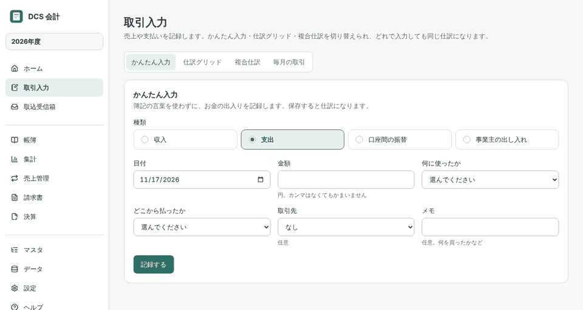
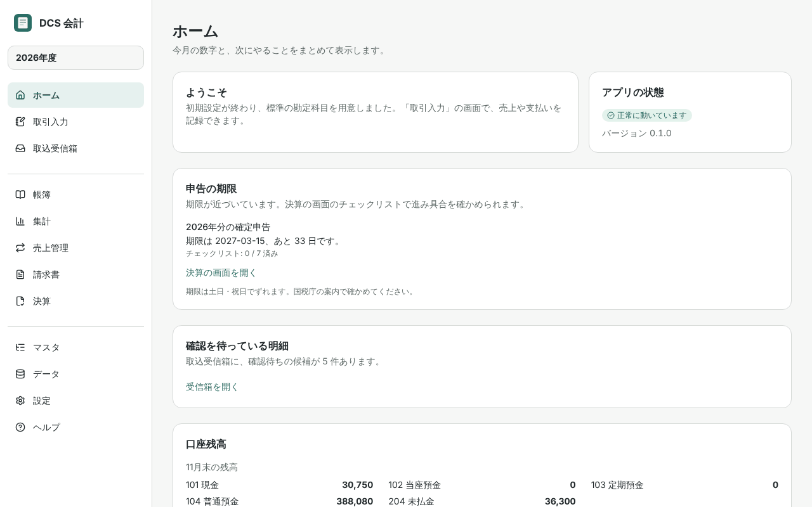
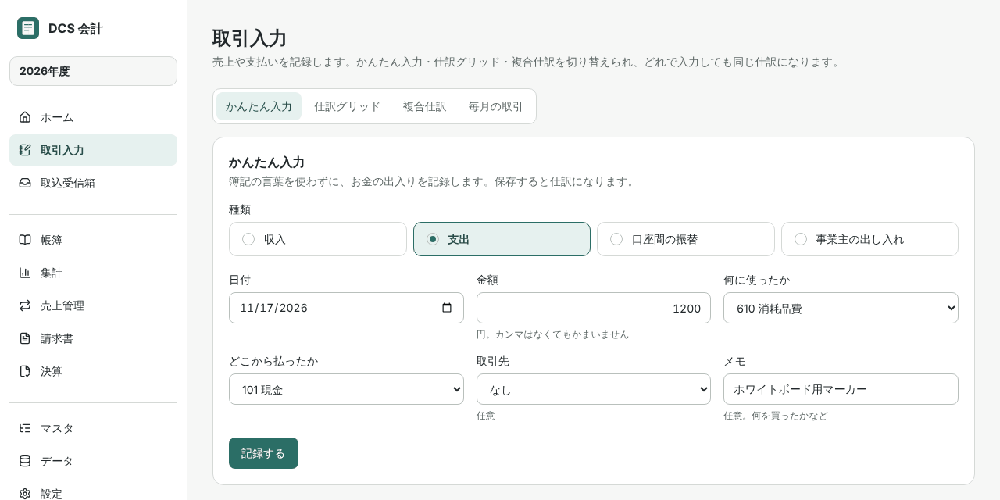
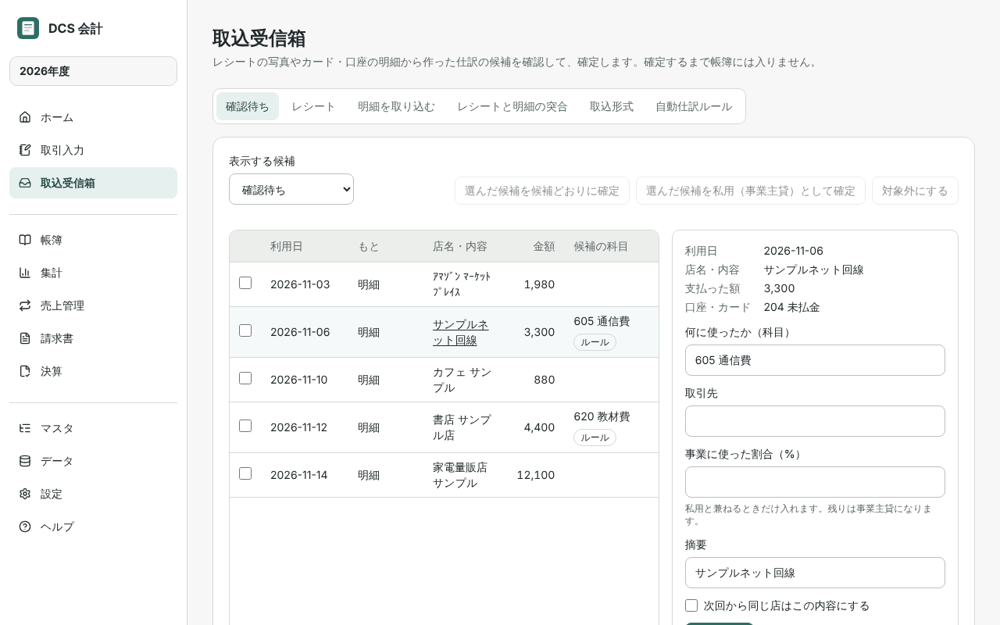
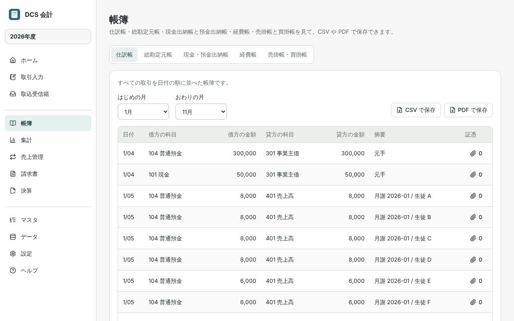
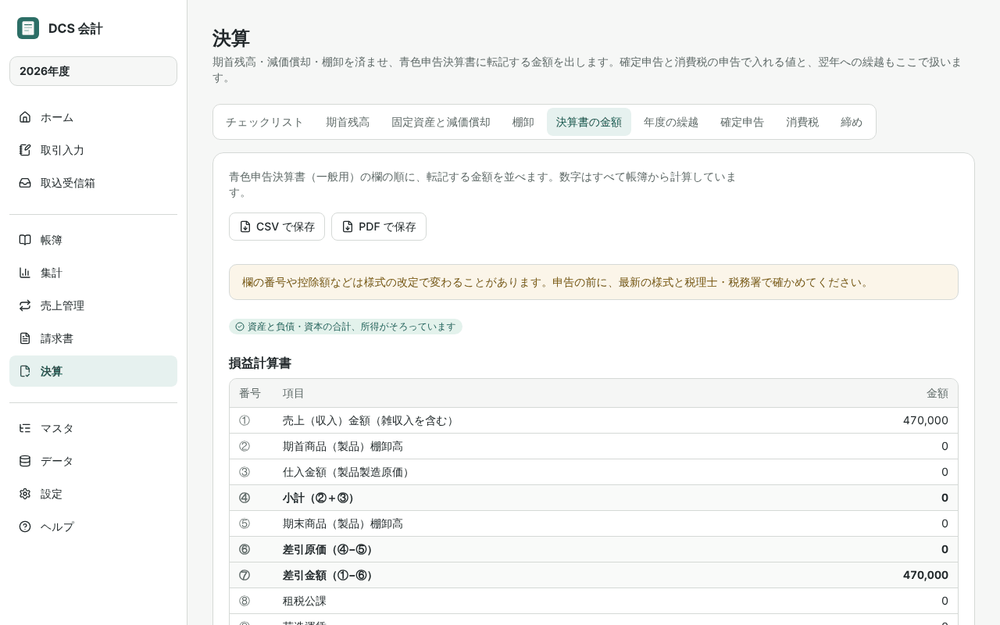
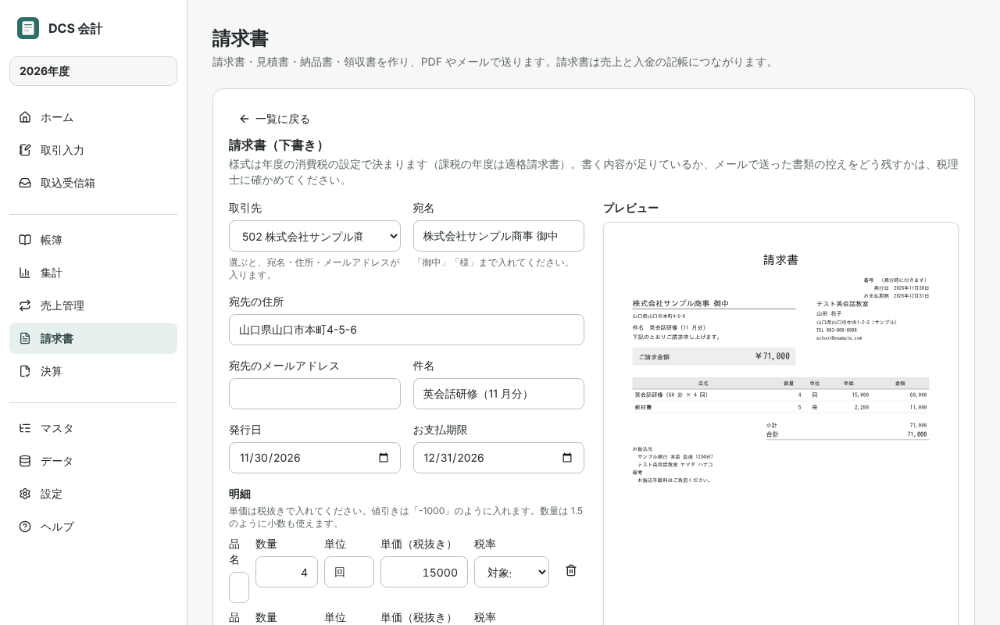
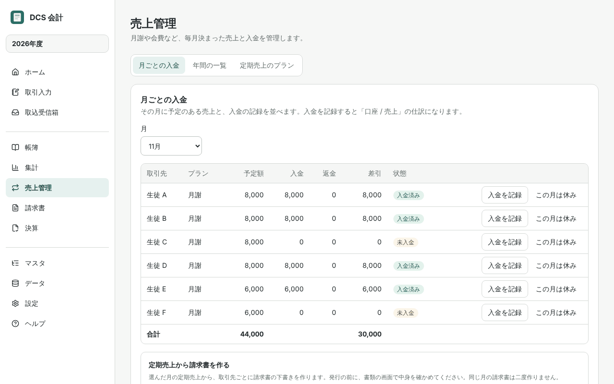

# 帳日和（Chobiyori）

個人事業主のための、確定申告までをひとつで済ませる会計アプリです。Windows と Mac で動きます。

**[最新版をダウンロードしてインストールする](https://github.com/naro9507/chobiyori/releases/latest)**（Windows / Mac〈Apple シリコン〉）

レシートやカード明細を読み込んで確かめるだけで、帳簿（お金の出入りの記録）ができあがります。決算と青色申告決算書の金額まで、アプリが計算します。簿記に慣れていなくても使えるよう、画面は「何に使ったか」「どこから払ったか」のような言葉で書いています。



> [!IMPORTANT]
> 税金の扱い（経費にできるか、按分の割合、控除の条件、申告の期限など）が正しいかは、必ず税理士か税務署に確かめてください。アプリの数字は、帳簿から計算した目安です。

## できること

| 画面 | できること |
|---|---|
| [ホーム](#ホーム) | 口座の残高、確認を待っている明細、申告の期限までの日数をひと目で見る |
| [取引入力](#取引入力かんたん入力) | 売上や支払いを記録する。簿記の言葉を使わない「かんたん入力」と、慣れた人向けの仕訳の入力 |
| [取込受信箱](#取込受信箱カード明細レシート) | カードや銀行の明細、レシートの写真から、記録の候補を作って確かめる |
| [帳簿](#帳簿) | 仕訳帳・総勘定元帳・現金出納帳・経費帳などを見る。CSV と PDF で保存する |
| [決算](#決算決算書の金額) | 減価償却や棚卸を済ませ、青色申告決算書に書く金額を出す。確定申告・消費税の申告の手伝い |
| [請求書](#請求書) | 請求書・見積書・納品書・領収書を作り、PDF やメールで送る |
| [売上管理](#売上管理) | 月謝や会費など、毎月決まった売上と入金を管理する |

### ホーム

今月の口座の残高と、次にやること（確認を待っている明細、申告の期限）をまとめて表示します。



### 取引入力（かんたん入力）

「収入・支出・口座間の振替・事業主の出し入れ」から選び、金額と「何に使ったか」「どこから払ったか」を入れるだけで記録できます。保存すると、簿記の形（仕訳）に自動で直します。



ほかに、Excel の帳簿のように番号で速く入力できる「仕訳グリッド」、毎月決まった支払い（家賃など）を候補に出す「毎月の取引」もあります。

### 取込受信箱（カード明細・レシート）

カードや銀行の明細（CSV・Excel）と、レシートの写真を読み込むと、記録の候補が並びます。前に選んだ科目やルールから「何に使ったか」を入れておくので、確かめて確定するだけです。確定するまで帳簿には入りません。



- 同じ明細を 2 回読み込んでも、二重には入りません。
- カード会社や銀行ごとの明細の形は、画面で自分で登録できます。楽天カードは楽天e-NAVIの利用明細CSV（UTF-8）に合う形式を同梱しています。初回は取込先を選んで保存してください。分割払いもCSVの「利用金額」で読み込むため、プレビューの合計は当月の請求額と異なることがあります。
- レシートの読み取りには Google の Gemini を使います（[設定](#あとから必要に応じて設定すること)が必要です）。

### 帳簿

仕訳帳・総勘定元帳・現金出納帳と預金出納帳・経費帳・売掛帳と買掛帳を見られます。どれも CSV と PDF で保存でき、税理士さんに渡すときに使えます。



### 決算（決算書の金額）

期首残高・固定資産と減価償却・棚卸を済ませると、青色申告決算書の欄の順に、書き写す金額を並べます。



- 確定申告: 国税庁の「確定申告書等作成コーナー」に入れる値を、入力の順にコピーできます。e-Tax の送信と、所得控除・税額の計算はしません。
- 消費税: 課税事業者の年は、2 割特例と簡易課税で納める額の目安を出します。
- インボイスの登録申請に書く内容と手順も案内します。
- 年末に、翌年の期首残高への繰越をします。

### 請求書

請求書・見積書・納品書・領収書を、横のプレビューで仕上がりを見ながら作れます。課税事業者の年は、適格請求書（インボイス）の形になります。



- PDF を添付して、アプリからメールで送れます（メールソフトを開いて送ることもできます）。
- 請求書から売上の記録を作り、入金を記録すると「入金済み」になります。

### 売上管理

月謝や会費など、毎月決まった売上の予定と入金を並べます。まだ入金がない月がひと目で分かります。



## はじめかた（使う人）

### 1. インストールする

[最新版のダウンロードページ](https://github.com/naro9507/chobiyori/releases/latest) の「Assets」から、使っているパソコンに合うファイルをダウンロードして開きます。

| パソコン | ファイル |
|---|---|
| Windows 10 / 11 | `.exe`（インストーラ） |
| Mac（Apple シリコン: M1 以降） | `.dmg` |

初めて開くときに、OS から警告が出る場合があります。

| パソコン | 出る警告 | 開き方 |
|---|---|---|
| Windows | 「Windows によって PC が保護されました」 | 「詳細情報」→「実行」 |
| Mac | 「開発元を検証できません」など | アプリを「アプリケーション」に移して一度起動し、システム設定の「プライバシーとセキュリティ」で「このまま開く」を選ぶ |

新しい版が出ると、アプリの中でお知らせし、そのまま更新できます。

### 2. 最初に設定する

1. **パスワードを決める**: 帳簿はこのパスワードで暗号化して保存します。帳簿を開いたら、設定の「復旧コード」でコードを発行し、パスワード管理アプリなど安全な場所に控えてください。 設定の「この端末でのログイン」で Google または Microsoft を連携すると、次回から端末の本人確認でも帳簿を開けます。
2. **初期設定**: 屋号・氏名・申告の区分（青色 / 白色）・消費税の扱い・業種を選びます。業種（教室・スクール、サービス業・フリーランス、小売・飲食など）に合わせて、よく使う科目を用意します。
3. あとはホームから使いはじめられます。

パスワードを忘れたら、起動画面の「パスワードを忘れたとき」から、控えておいた復旧コードと新しいパスワードを入力します。パスワードの変更や再設定の後は、復旧コードを発行し直してください。以前のバックアップを開くには、作成時のパスワードが必要です。

### あとから必要に応じて設定すること

| やりたいこと | 設定 |
|---|---|
| レシートの写真を読み取る | 設定の「レシートの読み取り」で、Google の Gemini の API キーを登録します。キーの取り方は画面で案内します（Google アカウントがあれば無料枠で使えます） |
| 請求書をアプリからメールで送る | 設定の「メールの送信」で、送信に使うメールアドレスを登録します。Gmail は「アプリ パスワード」を使います。手順は画面で案内します |

API キーとメールのパスワードは、パソコンの資格情報の保管場所（Windows の資格情報マネージャー、Mac のキーチェーン）に入れ、画面には出しません。

### データの置き場所とバックアップ

- 帳簿はパソコンの中にだけ保存します。インターネット上には保存しません。

  | パソコン | 場所 |
  |---|---|
  | Windows | `%APPDATA%\jp.dcs.accounting\books.db` |
  | Mac | `~/Library/Application Support/jp.dcs.accounting/books.db` |

- アプリを閉じるとき、変更があれば自動でバックアップを作ります（新しいものから 7 つ残します）。データの画面から、好きなときにバックアップを作ったり、戻したりできます。バックアップも同じパスワードで暗号化されます。
- パソコンの故障に備えて、ときどきバックアップのファイルを USB メモリなど別の場所にもコピーしてください。

## 大切なこと

- **税金のこと**: 税金の扱いと申告の内容が正しいかは、税理士か税務署に確かめてください。決算書の欄の番号や控除額、耐用年数、消費税の特例の期間などは、年によって変わることがあります。
- **外に送るもの**: アプリが外に送るのは次のものだけです。
  - レシートの画像（送ることに同意したときだけ。Google の Gemini に送ります）
  - 請求書などのメール（アプリから送ったときだけ）
  - 新しい版があるかの確認（GitHub）

  帳簿のデータは外に送りません。
- **まだ実物で確かめていないもの**: カードと銀行の明細の形（アメックス、楽天カード、ゆうちょ銀行、三菱UFJ銀行、三井住友銀行、楽天銀行、住信SBIネット銀行、山口銀行）は、見本から作ったもので、実物の明細では確かめていません。形が合わないときは読み込みを止めて知らせるので、間違って取り込むことはありません。そのときは画面で形を登録し直してください。

## 開発する人へ

```bash
git clone https://github.com/naro9507/chobiyori.git
cd chobiyori
make setup   # 依存のインストールと Git hooks の有効化
make dev     # アプリを起動する
```

前提のソフトは [プラットフォーム対応](./docs/PLATFORM_SUPPORT.md) を参照してください。押す前の検査（`make check`）は、Git hooks でも走ります。

### 資料

- [仕様書](./docs/SPEC.md): 機能・画面・データの決まりと、開発の進み具合
- [開発ガイド](./docs/DEVELOPMENT.md): 構成、コマンド、依存の安全（公開から 7 日待つ）
- [プラットフォーム対応](./docs/PLATFORM_SUPPORT.md): 対応 OS とインストーラ
- [リリースと自動アップデート](./docs/RELEASE.md): リリースの手順と署名の鍵

### 技術スタック

| 役割 | 技術 |
|---|---|
| アプリの枠 | Tauri v2 |
| バックエンド | Rust（DB・計算・取込・出力・PDF はすべてこちら） |
| 帳簿の保存 | SQLite + SQLCipher（暗号化）、`rusqlite` |
| 取込・出力 | `csv`・`encoding_rs`（Shift_JIS）・`calamine`（Excel）・`krilla`（PDF） |
| レシートの読み取り・メール | Gemini API（`reqwest`）・`lettre` |
| 画面 | React 19、Vite、TypeScript |
| UI | Tailwind CSS v4、shadcn/ui |
| ルーティング・データ取得・表 | TanStack Router / Query / Table / Virtual |
| 状態管理 | Zustand |
| テスト | Vitest（画面）、cargo test（Rust） |
| リント・整形 | Biome（画面）、Clippy・rustfmt（Rust） |

README のスクリーンショットは、架空のデータ（「テスト英会話教室」）で撮ったものです。
