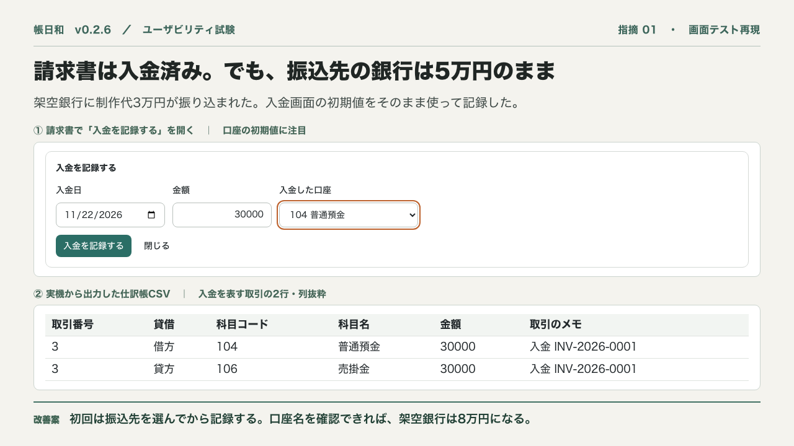
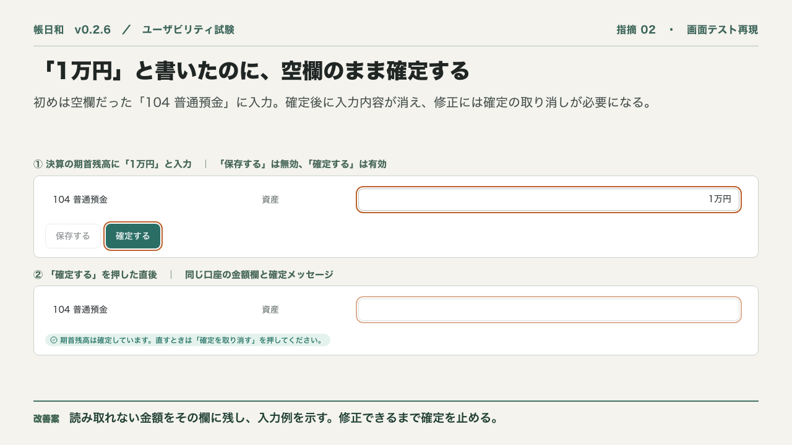
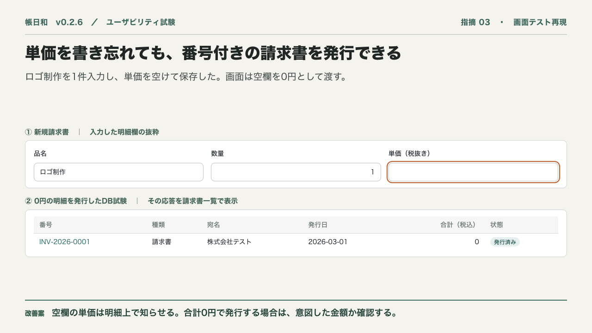
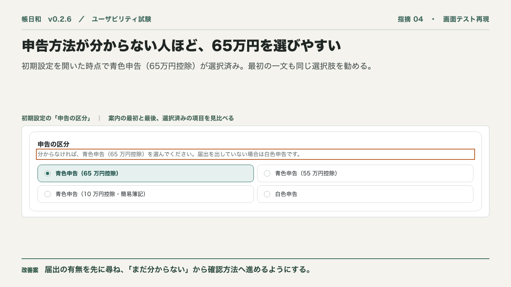
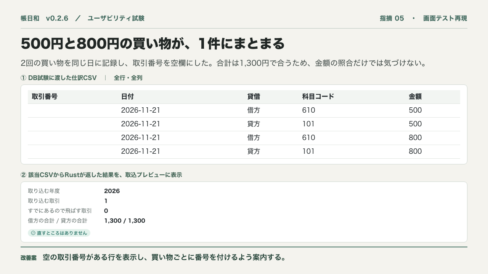
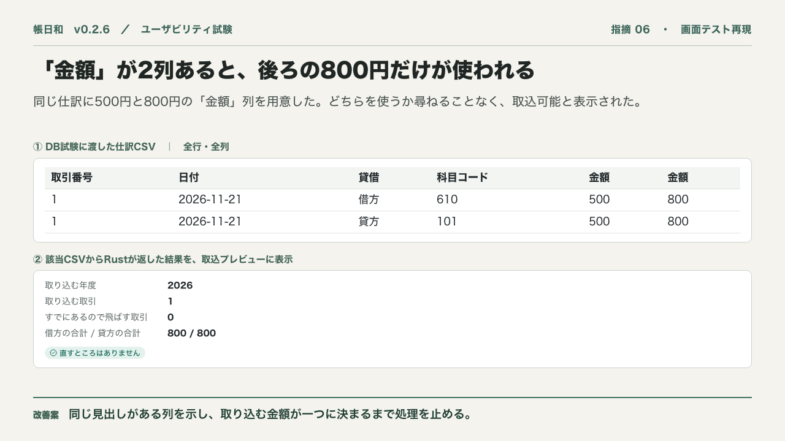
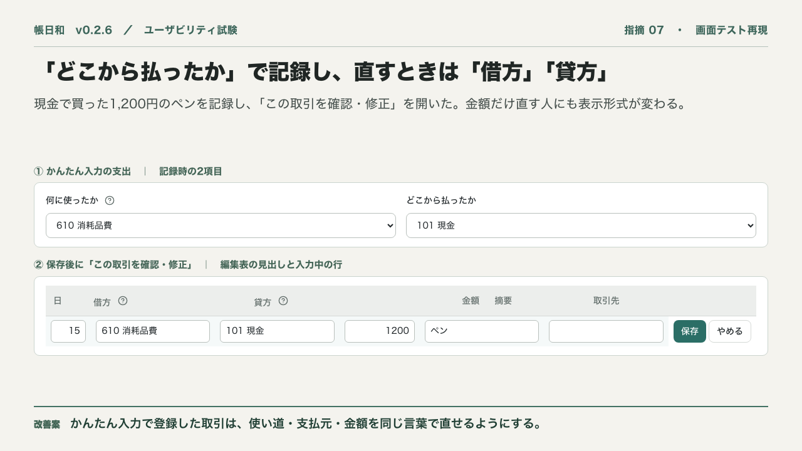
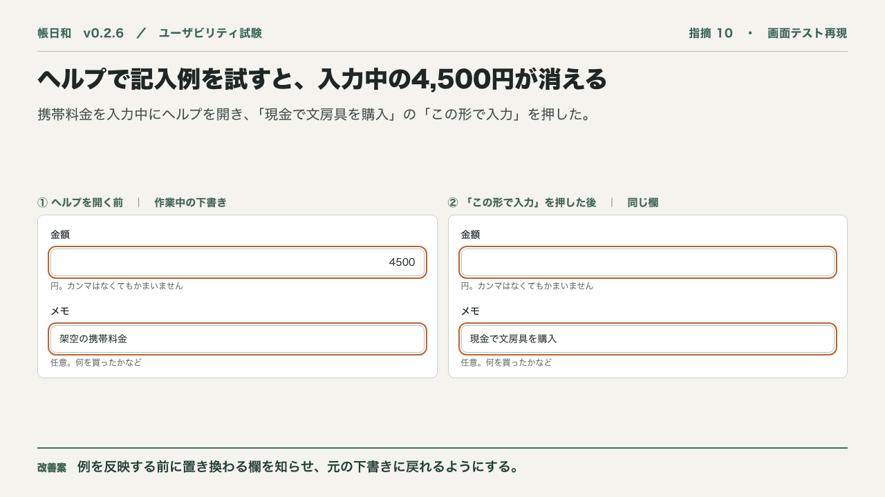
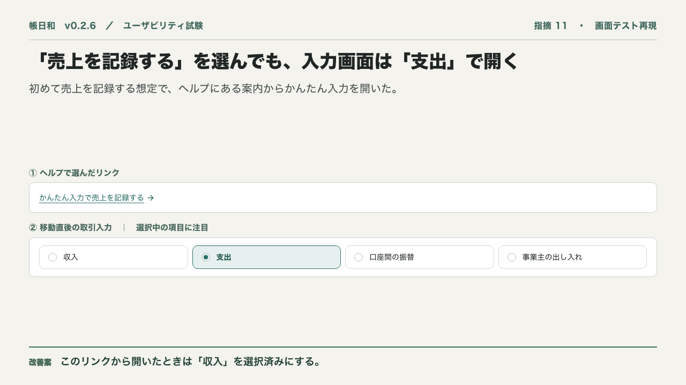
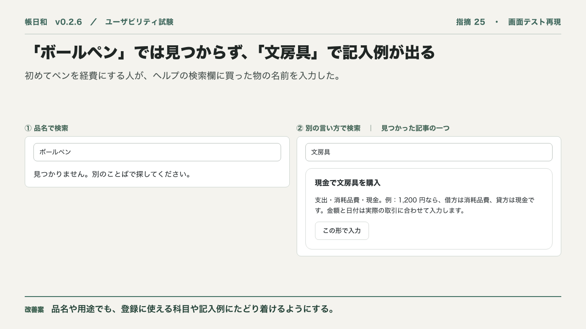

# 帳日和 v0.2.6 のどこで迷い、何が帳簿に残るか

[期首残高の動画を見る（MP4・18秒・字幕付き）](images/ux-v026/opening-balance.mp4)　｜　[全28件の試験結果と改善後の合格条件](UX_AUDIT_v0.2.6.md)

高優先度の6件と、会計を初めて使う個人事業主が日常作業で出会う4件を選んだ。画像の白い枠にはリリース版の画面テストで表示された項目を抜粋した。オレンジの枠と画面外の解説は注釈。動画は、同じ版の画面をブラウザで操作した5場面を順につないだもの。帳簿の応答には試験データを使った。実機の仕訳帳とRustのDB処理で照合した箇所は下記に記した。すべて架空の事業者・取引を使用した。

## 01　入金を済ませても、実際の振込先の残高が増えない

架空銀行に5万円ある状態で、制作代3万円の入金を記録した。初回の「入金した口座」にはすでに「104 普通預金」が入っている。ここを選び直さず記録すると請求書は入金済みになる。通帳なら8万円のはずが、帳簿の架空銀行は5万円のまま。下段のCSVを見ると、3万円がどこに記録されたか分かる。[実機で出力した仕訳帳CSV](images/ux-v026/payment-journal.csv)

## 02　「1万円」が消えても、確定は成功する

動画では5秒から普通預金欄と表の下の合計を見比べてほしい。欄には「1万円」とあるが、資産の合計は0で、貸借がそろっていると表示される。9秒から「確定する」に注目すると、13秒で確定済みの表示に変わり、欄が空になる。利用者が入力の誤りを知る機会はなく、やり直すには確定を取り消す必要がある。前回のmacOS実機試験でも再現した。[操作の5場面を見る](images/ux-v026/opening-balance.mp4)

## 03　単価の入力漏れが、発行済みの0円請求書になる

上段では品名と数量だけを入力した。保存時に画面が渡した単価は0だった。下段は、同じ条件で別途DBに保存して発行し、その結果を一覧に表示したもの。「合計（税込）」は0でも、番号と「発行済み」の印が付く。金額のエラーに気づくのは、次の「売上を記帳する」を押したときだった。DB試験のPDF生成には試験用関数を使った。

## 04　届出の有無が分からない人に、65万円控除を勧めている

初期画面では青色申告（65万円控除）が選択済み。案内は「分からなければ」でその選択肢を勧めた後に、届出を出していない場合は白色と続く。自分の届出状況が分からない人が、どちらの文に従うか決められない。届出の有無を先に尋ね、調べてから戻れる入口がほしい。

## 05　買い物が2回あっても、合計だけ見ると取込ミスに気づけない

同じ日の500円と800円の買い物を各2行で記録し、取引番号を空にした。下段の「取り込む取引」は1。一方、合計は期待どおり1,300円で「直すところはありません」と出る。DBでも取込後の件数は1件だった。

## 06　「金額」が2列あっても、使われる列を確認できない

見出しがどちらも「金額」の列に500と800を入れた。後ろの800が採用され、プレビューは「直すところはありません」と表示した。500円のつもりで用意した人が誤りを見抜くには、元ファイルの列を自分で照合する必要がある。05・06のプレビューには、それぞれのCSVをリリース版のRust処理で読んだ結果を使用した。

## 07　経費を登録するときと、金額を直すときで言葉が変わる

ペンを現金で買い、「何に使ったか」「どこから払ったか」に答えて記録した。同じ取引の「確認・修正」を開くと、消耗品費は「借方」、現金は「貸方」の欄に入っている。1,200円を直すだけでも、支払元や使い道が変わっていないか確かめるには、この対応を読み解く必要がある。

## 10　ヘルプの記入例が、作業中の下書きを置き換える

携帯料金4,500円を入力中に、ヘルプで文房具の例を開き「この形で入力」を押した。金額は空になり、メモは「架空の携帯料金」から「現金で文房具を購入」に変わった。通常のヘルプ往復では下書きが残るため、例を使う操作で何が置き換わるか分かりにくい。

## 11　売上を記録したい人が、支出の入力画面に着く

初めての入力でヘルプの「かんたん入力で売上を記録する」を選んだ。移動直後の選択は「支出」。案内のとおりに進んだ人が、自分で「収入」を選び直す必要がある。

## 25　買った物の名前では、記入例を見つけられない

「ボールペン」で探すと「別のことばで探してください」と出る。同じ買い物を「文房具」と言い換えると、そのまま入力に使える記事が出る。例は用意されていても、最初の検索結果には次に試せる言葉が出てこない。

